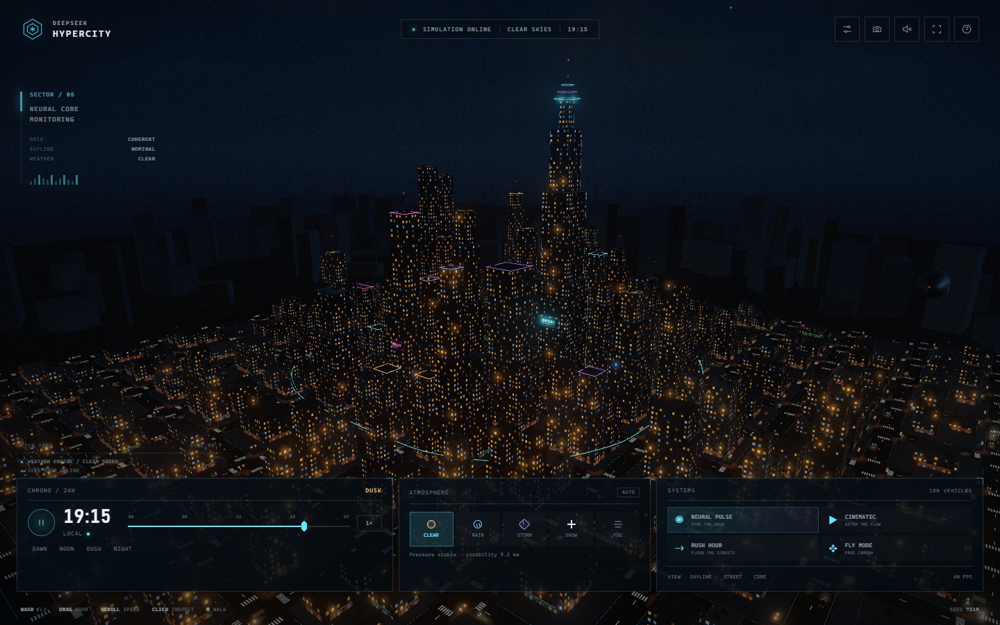
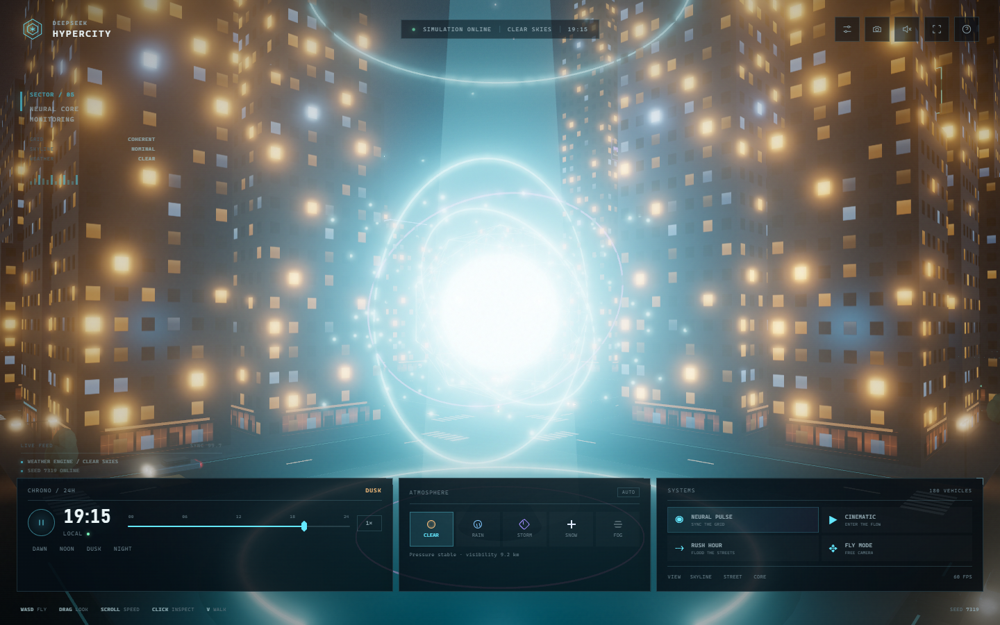
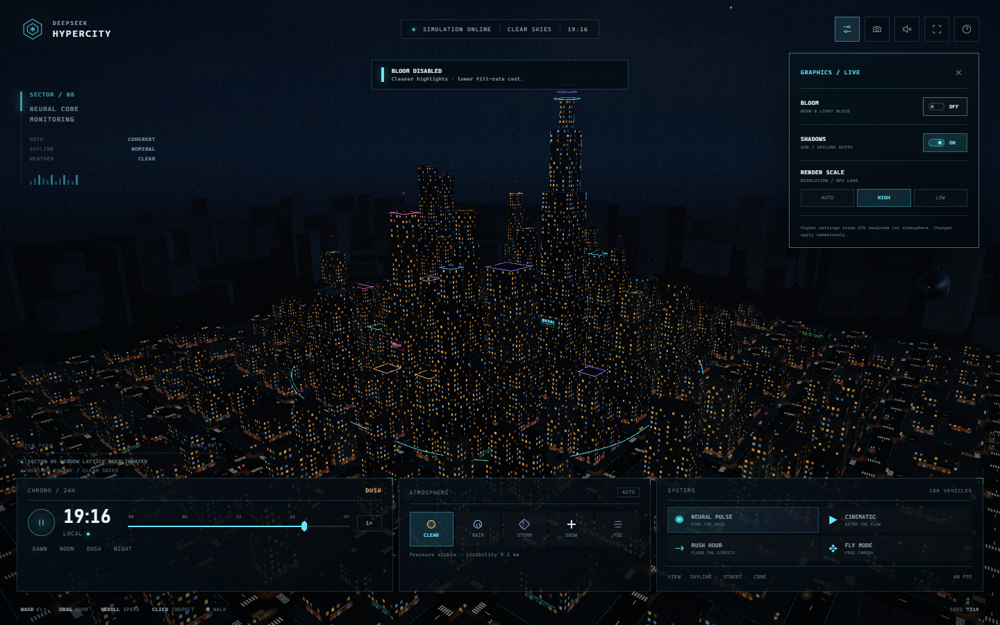
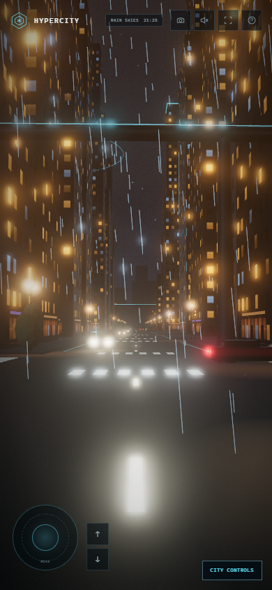
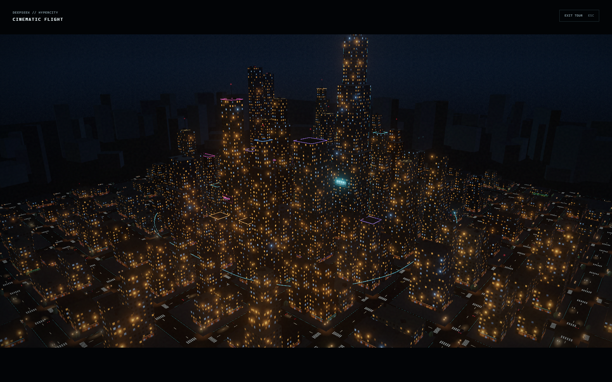
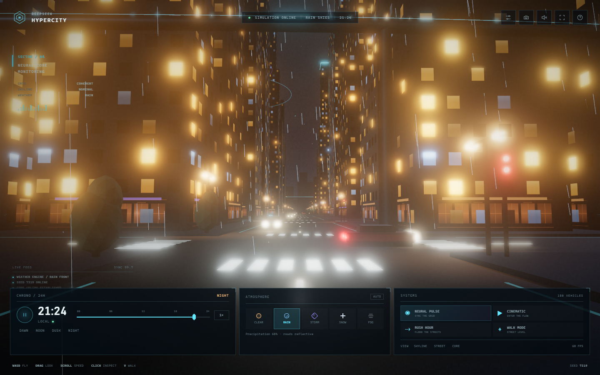
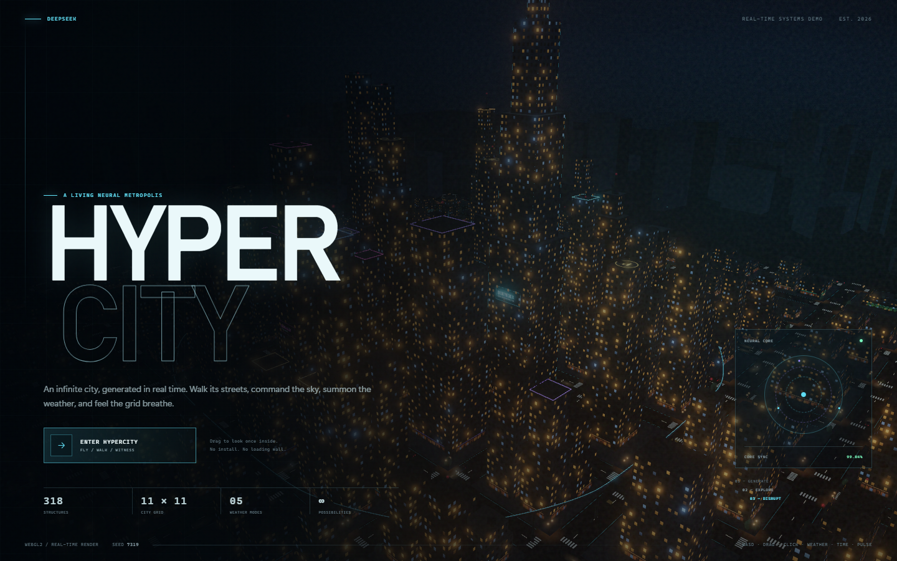

# DEEPSEEK // HYPERCITY

A real-time, procedural 3D city built for the browser. Fly above the skyline, walk the rainy avenues, inspect the buildings, summon a storm, race the clock from daylight to deep night, and fire a Neural Pulse across the city grid.

Everything is generated and rendered at runtime with Three.js and WebGL2. No external models, textures, image assets, map data, API keys, or network requests are required after the app loads.

**Live:** <https://hypercity.pages.dev> — `main` deploys to production via GitHub Actions → Cloudflare Pages; pull requests get their own preview URL.



## Run it

```bash
pnpm install
pnpm dev
```

Open **http://127.0.0.1:5173/**.

Production build:

```bash
pnpm build
pnpm preview
```

The app needs a current desktop browser with WebGL 2 and hardware acceleration. It also has a compact touch layout for phones and tablets.

## What is in the city

- A seeded **11 × 11-block procedural city**: more than 300 buildings, four districts, a park, a landmark supertall, and a central Neural Core plaza.
- Animated **day and night cycle**, including sun, moon, stars, dynamic cloud cover, blue-hour skies, building windows turning on at dusk, neon roof bands, and street lighting.
- Five simulated weather states with smooth transitions: **clear, rain, storm, snow, and fog**.
  - Volumetric-looking rain and snow particles.
  - Lightning, thunder, sky flashes, splash rings, wet-road gloss, and denser fog.
- **180 moving vehicles** with turn routing, traffic lights, car-following, headlights, taillights, and ground light pools — plus **60 more during Rush Hour**.
- An elevated **monorail**, a city airship, 20 wandering drones, street lamps, traffic signals, crosswalks, storefronts, trees and benches.
- A gigantic **Neural Core** with a light pillar, rotating holographic rings, particles, and a pulsing grid-wide light wave.
- A dynamic **cinematic camera tour**, photo mode, first-person-style walking, building inspection dossiers, and an in-app **graphics panel** for bloom, shadows, and render scale.



## Controls

| Input | Action |
| --- | --- |
| Drag | Look around |
| `W` `A` `S` `D` | Move / strafe |
| `Q` / `E` | Descend / ascend |
| `Shift` | Boost |
| Mouse wheel | Adjust flight speed |
| `V` | Toggle Fly / Walk |
| Click a building | Open its structural dossier |
| Click the Neural Core | Trigger a pulse at the core |
| `N` or `P` | Neural Pulse |
| `C` | Cinematic tour |
| `T` | Rush Hour |
| `M` | Toggle ambient audio |
| `G` | Graphics settings |
| `F` | Photo mode |
| `H` | Help |
| `Esc` | Close panel / exit tour |
| `Space` | Pause or resume time |

The bottom cockpit gives you direct control over time, weather, traffic, camera presets, and audio. On touch devices, the movement joystick and lift buttons appear over the scene, and **CITY CONTROLS** opens the compact command deck.

Press `G` (or the sliders icon in the top bar) to open the graphics panel. Bloom, directional shadows, and render scale can be changed live without reloading — useful for trading visual atmosphere against frame rate.





The cinematic tour removes the cockpit entirely and hands the city to the camera:



At eye level, the simulation becomes a first-person city walk with collision, traffic, storefronts, rain, and overhead monorail:



## URL scenes and in-page API

Every scene is reproducible. Useful query parameters:

| Parameter | Values | Description |
| --- | --- | --- |
| `seed` | any number | Deterministic city layout |
| `time` | `0`–`24` | Starting hour |
| `weather` | `clear`, `rain`, `storm`, `snow`, `fog` | Starting weather |
| `timeScale` | number | Day-cycle speed; `0` pauses |
| `autoWeather` | `0` / `1` | Enable automatic weather changes |
| `skipIntro` | `0` / `1` | Bypass the intro overlay |
| `mode` | `fly`, `walk` | Starting camera mode |
| `tour` | `0` / `1` | Start the cinematic tour |
| `photo` | `0` / `1` | Hide the interface |
| `quality` | `auto`, `high`, `low` | Render-scale mode |
| `bloom` | `0` / `1` | Start with bloom enabled or disabled |
| `shadows` | `0` / `1` | Start with shadows enabled or disabled |
| `lightning` | `0` / `1` | Trigger a lightning strike shortly after load |

Example:

```
http://127.0.0.1:5173/?seed=7319&time=22.6&weather=storm&skipIntro=1
```

The live app exposes a documented control surface:

```js
await window.hypercity.ready;
window.hypercity.setTime(21.5);
window.hypercity.setWeather('rain');
window.hypercity.setCameraPreset('core');
window.hypercity.pulse();
window.hypercity.getMetrics();
```

Available methods: `setTime`, `setTimePaused`, `setTimeScale`, `setWeather`, `setAutoWeather`, `setCameraPreset`, `setCameraMode`, `inspectBuilding`, `pulse`, `forceLightning`, `startTour`, `stopTour`, `setTrafficProfile`, `setPhotoMode`, `setAudioEnabled`, `setBloomEnabled`, `setShadowsEnabled`, `setQuality`, `getMetrics`, and `enter`.

## How it works

- `src/world/generateCity.ts` turns a seed into blocks, lots, setbacks, roof equipment, window metadata, props, trees, and colliders.
- `src/world/buildWorld.ts` builds the instanced city, buildings, mip-mapped window facades, stores, signs, core, monorail, airship, drones, and street furniture.
- `src/render/sky.ts` owns the sky shader, atmospheric palette, lights, fog, stars, sun, and moon.
- `src/render/post.ts` handles HDR post-processing and bloom.
- `src/sim/weather.ts` owns transitions, particles, lightning, thunder hooks, and rain ripples.
- `src/sim/traffic.ts` owns the traffic graph, signal cycle, vehicles, headlight glows, and parking.
- `src/camera/` contains the free-flight/walk controller and the cinematic spline tour.
- `src/ui/` contains the hand-built HUD, intro, inspector, help overlay, graphics panel, mobile controls, and styles.
- `src/audio/engine.ts` synthesizes the ambient city, rain, wind, sub-bass pulse, and thunder with the Web Audio API.

Distant facade windows are sampled from a pre-baked, mip-mapped window atlas so that sub-pixel light cells resolve to smooth averages instead of shimmering fragments. All moving meshes use preallocated instance matrices; vehicles and particles use pooled arrays. Resolution drops automatically if the smoothed frame rate falls below the target. Window overlays also use polygon depth bias and an increased façade offset to prevent z-fighting at grazing angles.

## Verification

```bash
pnpm typecheck
pnpm build
pnpm smoke
pnpm test:interactions
pnpm test:graphics
```

The last three scripts use `playwright-core` against the locally installed Microsoft Edge at `C:\Program Files (x86)\Microsoft\Edge\Application\msedge.exe`. They cover all weather modes, the intro handoff, raycast selection, the inspector, timeline control, weather switching, pulse, audio, help, the tour, photo mode, the API, keyboard walking, and the graphics panel.

Latest local checks: **22/22 interaction checks** and **8/8 graphics checks** passed, with no page or console errors.



## Notes and scope

This is a self-contained visual systems demo, not a live LLM integration. The DeepSeek identity, Neural Core, telemetry, and pulse are artistic framing for a real-time rendering and simulation showcase. There is no backend, no user tracking, and no external service dependency.

The demo is intentionally desktop-first; touch gets a compact joystick and collapsible command deck. Audio is opt-in to respect browser autoplay rules and is off by default.

Built with [Three.js](https://threejs.org/) and [Vite](https://vite.dev/).
